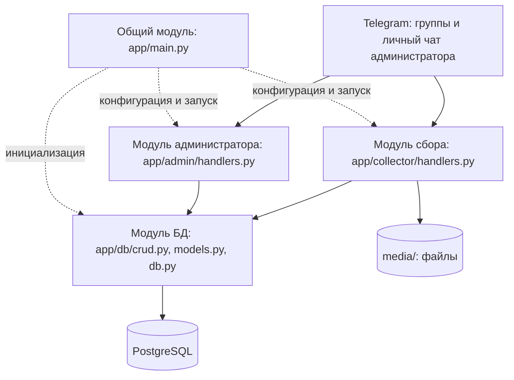

# Архитектура проекта «Сборщик корпоративных переписок Telegram»

## 1. Назначение
Система архивирует новые сообщения из разрешённых корпоративных групп Telegram, сохраняет текст, сведения об отправителях, вложения и доступные события реакций в PostgreSQL. Уполномоченные пользователи выгружают историю за период через личный чат с ботом. Программа должна быть запущена, чтобы получать новые события.

## 2. Технологии и выбор способа интеграции
- **Python 3.11** — язык реализации.
- **aiogram 3 / Telegram Bot API** — приём обновлений и обработка команд.
- **PostgreSQL** — реляционное хранилище сообщений и метаданных.
- **SQLAlchemy 2 + psycopg2** — слой доступа к базе данных.
- **python-dotenv** — загрузка настроек из локального `.env`.
- **openpyxl + csv** — выгрузки в Excel и CSV.
- **Локальная папка `media/`** — загруженные вложения; метаданные хранятся в PostgreSQL.

### Bot API и TDLib
| Критерий | Bot API | TDLib |
|---|---|---|
| Работа с новыми сообщениями | Да, при корректных настройках и правах бота | Да, с правами авторизованной учётной записи |
| Команды администратора | Удобно реализовать | Требует собственного клиентского интерфейса |
| Доступ к старой истории до добавления | Произвольный доступ отсутствует | Может быть доступна в рамках разрешений аккаунта |
| Сложность первого прототипа | Невысокая | Выше |

Для минимальной версии выбран **Bot API**: задача предполагает добавление бота в рабочие чаты и архивирование поступающих сообщений. Если потребуется исторический импорт до добавления бота, решение нужно пересмотреть.

## 3. Модульная архитектура

**Модуль сбора:** фильтрует сообщения групп, извлекает текст и метаданные, загружает поддерживаемые вложения, принимает доступные обновления реакций и вызывает операции БД.

**Модуль администратора:** ограничивает команды личным чатом, проверяет числовой Telegram ID по списку `ADMIN_IDS`, разбирает диапазон дат, получает записи через слой БД и отправляет `.xlsx` и `.csv`.

**Модуль БД:** определяет таблицы, создаёт соединение с PostgreSQL и предоставляет операции создания/получения пользователей, чатов, сообщений, вложений и реакций.

**Общий модуль:** загружает `.env` через `load_dotenv()`, создаёт Telegram Bot и Dispatcher, регистрирует маршрутизаторы, инициализирует базу и запускает polling.

## 4. Модель данных

| Таблица | Содержимое |
|---|---|
| `users` | Telegram ID, username, имя, фамилия |
| `chats` | Telegram ID чата, название и тип |
| `messages` | Чат, автор, Telegram ID сообщения, текст, дата, ссылка на ответ |
| `attachments` | Связь с сообщением, тип, Telegram file_id, имя и локальный путь |
| `reactions` | Связь с сообщением и автором, эмодзи, момент изменения |

Связи: чат 1:N сообщения; пользователь 1:N сообщения; сообщение 1:N вложения; сообщение 1:N реакции. Пара `(chat_id, telegram_message_id)` уникальна в таблице сообщений.

## 5. Основные сценарии

**Сбор:** Telegram отправляет обновление → модуль сбора выделяет содержимое → модуль БД сохраняет метаданные → вложения сохраняются в `media/` → сведения о файлах связываются с сообщением.

**Экспорт:** администратор отправляет `/export YYYY-MM-DD YYYY-MM-DD` → модуль проверяет ID и корректность периода → выбирает данные → создаёт CSV и XLSX → отправляет файлы администратору.

## 6. Известные ограничения
- Bot API не предоставляет произвольный импорт старой истории до подключения бота.
- Приём реакций зависит от прав бота и типов событий Telegram; анонимные реакции могут не иметь ID пользователя.
- Выгрузка содержит пути к файлам, но не сами вложения внутри CSV/XLSX.
- Программа получает новые сообщения, только пока работает; её текущая реализация не обещает полного восстановления пропущенных событий.
- Обрабатываются не все разновидности событий Telegram, например редактирования и удаления могут не отражаться в архиве.

## 7. Защита данных
Работать только с согласованными корпоративными чатами и тестовыми данными. Хранить секреты только в `.env`, исключать его из Git, не демонстрировать токен и пароль в видео, ограничивать административный экспорт числовыми Telegram ID, соблюдать внутренние правила хранения и удаления переписок.

## 8. Критерии минимального приёмочного тестирования
1. Бот запускается и подключается к PostgreSQL.
2. Текстовое сообщение в группе появляется в `messages`.
3. Фото или документ появляется в `attachments`, файл сохраняется в `media/`.
4. Поддерживаемая реакция появляется в `reactions`, если Telegram присылает обновление.
5. Авторизованный администратор получает CSV/XLSX за выбранные даты.
6. Неавторизованный пользователь получает отказ в доступе.
